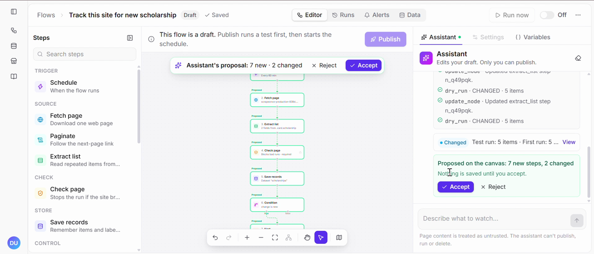
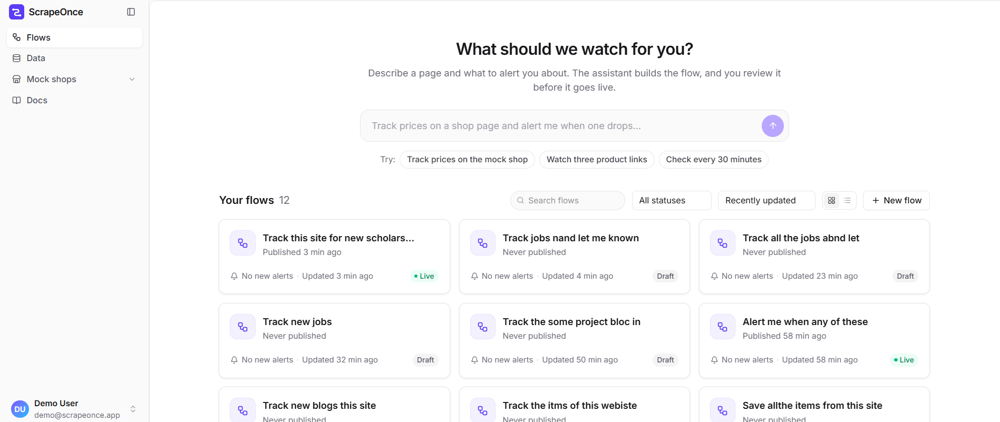
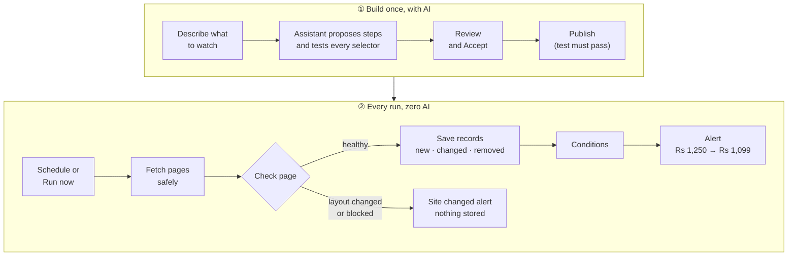

<div align="center">

# ScrapeOnce

### AI-powered website monitoring without AI on every run

**SE-MAX · CUI Tech Fest FA'26 · Team LazyLoaders**

[](https://github.com/muhammadusamahoyrr/ScrapeOne/actions/workflows/ci.yml)
[](https://www.python.org/)
[](https://nodejs.org/)
[](https://scrapeonce-production-839d.up.railway.app)

**Describe what to watch. Build a flow. Publish it. Get reliable alerts.**

[Live Demo](https://scrapeonce-production-839d.up.railway.app) ·
[Judge Checks](docs/judge-checks.md) ·
[Requirements](docs/requirements.md)

</div>

---

## Overview

ScrapeOnce is a no-code website-monitoring builder for small sellers and shoppers.
Describe what you want to monitor in plain language, and an AI assistant creates a
validated workflow on a visual canvas.

After you publish the workflow, every scheduled run uses deterministic rules with
**no AI calls**. ScrapeOnce can notify you when:

- Prices change
- New items appear
- Existing items disappear
- A website layout changes or becomes unavailable

> **Core idea:** AI builds the workflow once; predictable, explainable code runs it
> every time after that.

## Product Demo

https://github.com/user-attachments/assets/8111b61c-e9c2-42f5-90db-241123c3fca4

[](docs/media/scrapeonce-demo.mp4)

> **One-minute walkthrough:** Ask the assistant to watch a scholarship board. It
> fetches the page, tests selectors, runs a test, and proposes a flow on the canvas
> for approval. Click the image above to play the video.

### Home Screen



Describe what to watch in one sentence or choose a suggestion. Each flow shows its
status, recent alerts, and last run time. The sidebar links to the Data page and
the project's demo sites.

## How It Works



### Key Principles

- **AI builds, code runs.** The assistant edits drafts through typed tools. Every
  edit is validated and shown for approval. It cannot publish, run, or delete.
- **Published runs never call AI.** Every run reports `ai_calls: 0`.
- **Every run has one clear verdict**, checked in this order:
  **Blocked** → **Unsupported** → **Broken** → **Suspect** → **Changed / OK**.
- **Broken pages do not corrupt data.** A CAPTCHA page cannot appear as “all
  products removed,” and a broken layout never stores empty prices.
- **Flows are visual and explainable.** Steps include scheduling, fetching,
  pagination, extraction, loops, conditions, waiting, page checks, saving records,
  alerts, and results.

## Safety and Reliability

- **No internal requests:** only `http` and `https` are allowed. Private, loopback,
  and cloud-metadata addresses are refused after DNS resolution and on every
  redirect.
- **Bounded execution:** 15 seconds per page, 2 MB after decompression, 2 seconds
  between requests to one site, 120 seconds per run, and a maximum of 25 loop items.
- **Flows are data, not code:** strict schemas, fixed operators, no scripts, no
  regex, and no templates. Page text is treated as untrusted input.
- **Honest scraping:** a clear User-Agent is used. CAPTCHA solving and proxies are
  not supported.
- **Demo-safe:** during the event, the project scrapes only its own mock shop with
  invented products.

## Live Deployment

- **URL:** [scrapeonce-production-839d.up.railway.app](https://scrapeonce-production-839d.up.railway.app)
- **Health check:** [`/health`](https://scrapeonce-production-839d.up.railway.app/health)
- **Platform:** Railway primary, Render backup
- **Runtime:** One Docker image serves the editor, API, and mock shop

## Judge Quick Start

You can evaluate the main flow in under five minutes:

1. Open the [live demo](https://scrapeonce-production-839d.up.railway.app).
2. Click **Track prices on the mock shop**.
3. Review the proposed steps, click **Accept**, and then click **Publish**.
4. Click **Run now** and inspect the step-by-step results.
5. Open the **Runs** tab and verify the verdict and **AI calls: 0**.
6. In `/shop/admin`, change a product price and run the flow again.
7. Open **Alerts** and verify the price-change notification.
8. Switch the mock shop to layout v2 and run it again.
9. Confirm the run is marked **Broken**, no invalid data is stored, and the last
   known-good prices remain available in **Data**.

See the complete [step-by-step judge checks](docs/judge-checks.md).

## Feature Status

| Area | Status |
|---|---|
| Editor: flow list, canvas, step palette, settings, variables, test drawer, publishing | ✅ Built |
| Assistant: typed tools, model fallback, proposal review, no publish tool | ✅ Built and tested |
| Flow schema, graph rules, storage, and version checks | ✅ Built |
| Safe fetching, URL/IP checks, redirects, limits, normalisers, and mock shop | ✅ Built |
| Runner, verdicts, records, conditions, alerts, scheduler, loops, pagination, CSV export | ✅ Built |
| Runtime variables and data selector for step settings | ✅ Built |
| PII value scan (FR-34) | 🟡 Planned |
| Browser steps: click, scroll, and type | ⏸️ Not planned; shown disabled and refused at publish |

The status of every requirement is documented in [docs/requirements.md](docs/requirements.md).

## Run Locally

### Prerequisites

- Python 3.12 and [uv](https://docs.astral.sh/uv/)
- Node.js 22 or newer and npm

### Setup

```bash
uv sync
npm --prefix web install
```

### Environment Variables

Copy `.env.example` to `.env` and add only the values needed for your environment.
Never commit secrets.

| Variable | Required for |
|---|---|
| `DATABASE_URL` | PostgreSQL. Leave empty locally to use SQLite; required on Railway and Render |
| `AI_MODEL`, `AI_FALLBACK_MODEL` | The assistant's primary and fallback models |
| `GEMINI_API_KEY`, `GROQ_API_KEY`, `ANTHROPIC_API_KEY` | Credentials for configured models |
| `GEMINI_API_KEY_2`, `GROQ_API_KEY_2`, `ANTHROPIC_API_KEY_2` | Optional backup provider keys |
| `PUBLIC_BASE_URL` | Public URL used for mock-shop links |

Without an AI key, the assistant displays **offline**, while the rest of the
application remains usable.

### Start the Application

```bash
uv run uvicorn app.main:app --port 8000 --workers 1
```

In a second terminal:

```bash
npm --prefix web run dev
```

Open [http://localhost:5173](http://localhost:5173). The development server
forwards `/api`, `/health`, and `/shop` to port 8000.

To work on the UI without the backend, set `VITE_API_MODE=mock` in `web/.env`.

### Run Tests

```bash
bash scripts/test.sh
npm --prefix web run build
```

The test script runs Ruff and all tests except `live` tests, which require real
model credentials.

## Deployment

The `Dockerfile` builds the editor and runs FastAPI with one worker. The scheduler
runs inside the application.

1. Add a PostgreSQL database to the Railway project.
2. Set `DATABASE_URL` to `${{Postgres.DATABASE_URL}}`.
3. Configure `PUBLIC_BASE_URL` and the required AI variables.
4. Deploy and verify that `/health` returns:

   ```json
   {"status":"ok","database":"ok"}
   ```

The application requires `DATABASE_URL` in hosted environments because the host
disk is wiped between deployments.

## Quality

- **451 automated tests** run by GitHub Actions on every push.
- Tests cover internal URL refusal, zero-AI runs, layout-change detection,
  deterministic repeated output, oversized or slow pages, and malformed AI replies.
- Defects and test details are recorded in [docs/testing.md](docs/testing.md).
- AI usage is documented in [docs/ai-usage-log.md](docs/ai-usage-log.md).

## Known Limitations

- Static HTML only. JavaScript-rendered pages are reported as **Unsupported**.
- A recorded real-model response is still to be added:
  `uv run pytest -m live -k capture`.
- There is no sign-in, so anyone with the URL can view and edit flows.
- The assistant rate limit is stored in memory and resets when the app restarts.

## Related Work

Generating a scraper once and running it without AI is not new. Related projects
include **Crawlr**, **harvest-agent**, **Crawl4AI**, **Parsera**, and **Kadoa**.

ScrapeOnce focuses on:

1. A no-code editor and assistant for non-developers.
2. User approval after a validated test run.
3. A clear verdict and evidence for every run.
4. Deterministic execution without AI after publication.

## Documentation

- [Requirements](docs/requirements.md)
- [Design](docs/design.md)
- [Testing](docs/testing.md)
- [AI usage log](docs/ai-usage-log.md)
- [Judge checks](docs/judge-checks.md)
- [Contracts](specs/contracts.md)
- [Workstreams](specs/workstreams.md)
- [Architecture decisions](specs/adr/)

## Team

| Member | Responsibility |
|---|---|
| **Muhammad Usama** | Backend engine, scraping safety, runner, database, deployment, and infrastructure |
| **Kaleem Hassan** | Frontend editor, visual canvas, flow settings, assistant integration, and user experience |
| **Umar Hassan** | Testing and quality assurance, documentation, demo preparation, requirements tracking, and project presentation |

## License

This project was created for **CUI Tech Fest FA'26** by **Team LazyLoaders**.
