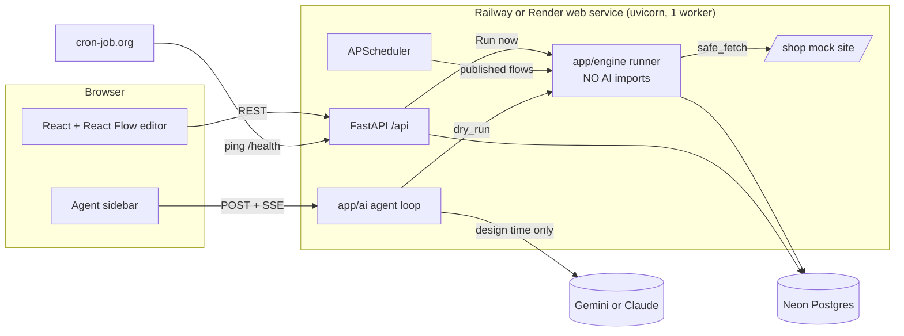

# Design

## Architecture overview

ScrapeOnce is a no-code scraping workflow builder. A user, helped by a sidebar AI agent, builds a **flow**: a graph of nodes on a canvas. Once the user publishes a flow, it runs on its own schedule. **Runs never call AI.**

Everything is one service, deployed from one Dockerfile to **Railway** (primary) or **Render** (backup):



- **The flow JSON holds everything**, including the schedule (in the Trigger node), conditions and alerts.
- **Draft and published copies.** Edits go to the draft. **Publish** copies the draft to the published copy and registers its schedule. The scheduler and "Run now" only ever run the published copy.
- **The agent edits the draft only.** Only the user can publish.

Related documents:
- [Requirements](requirements.md): FR and NFR IDs referenced below.
- [Contracts](../specs/contracts.md): exact flow JSON, API shapes, agent events.
- [Workstreams](../specs/workstreams.md): the build split into two parallel streams.
- [Architecture decisions](../specs/adr/).

## Components

| Component | Responsibility | Technology |
|---|---|---|
| Web UI | Flow list, canvas editor, node palette, settings panel, Runs / Results / Alerts tabs | Vite, React, TypeScript, @xyflow/react, Zustand, TanStack Query, Tailwind, dagre |
| Agent sidebar | Chat with the agent about the open flow; shows its edits as pending changes the user accepts or rejects | @microsoft/fetch-event-source (SSE over POST) |
| API | REST for CRUD; SSE for agent chat and live run progress; serves the React build and the mock shop | FastAPI, sse-starlette |
| Flow schema | Each node type is a Pydantic model (discriminated union on `type`, `extra="forbid"`); validates every agent edit, save and publish | Pydantic v2 |
| Agent | Tool-calling loop over a copy of the draft (at most 8 tool calls per message); Gemini primary, Claude fallback | **PydanticAI** (`Agent`, `FallbackModel`, typed tools) in `app/ai/`; `AI_MODEL`, `AI_FALLBACK_MODEL` |
| Engine | Runs a flow through the graph in dependency order; pure functions except `safe_fetch` | `app/engine/` (httpx, selectolax) |
| Fetcher | `safe_fetch()`: http/https only, IPs checked after DNS lookup and after every redirect (at most 3), timeouts, 2 MB cap | httpx (async) |
| Classifier | One verdict per run (BLOCKED, UNSUPPORTED, BROKEN, SUSPECT, CHANGED, OK, UNKNOWN) | `app/engine/classify.py` (pure function) |
| Scheduler | One job per published flow, built from its Trigger node; rebuilt from the database at startup | APScheduler 3.x (AsyncIOScheduler) |
| Database | Flows, runs, datasets, records, record changes, alerts | Neon Postgres, SQLAlchemy 2 + asyncpg |
| Mock shop | Our own test site with invented data: v1 list (2 pages), v2 layout, blocked, JavaScript shell, duplicates, product pages, admin (change price, remove product, switch layout), and robustness pages `/shop/huge`, `/shop/slow`, `/shop/file.pdf`, `/shop/redirect-internal` | FastAPI + Jinja at `/shop` (Jinja is used only for the mock shop) |

## Flow model

```json
{
  "version": 4,
  "nodes": [
    {"id": "t1", "type": "trigger",        "config": {"mode": "interval", "every_minutes": 60, "timezone": "Asia/Karachi"}},
    {"id": "f1", "type": "fetch_page",     "config": {"url": "https://<app>.onrender.com/shop"}},
    {"id": "p1", "type": "paginate",       "config": {"next_selector": "a.next", "max_pages": 3}},
    {"id": "e1", "type": "extract_list",   "config": {
        "base_selector": "div.product", "identity_key": "url",
        "page_anchor": "#product-grid", "expected_count": {"min": 10, "max": 40},
        "fields": [
          {"name": "title", "selector": "h2",     "type": "text",  "required": true},
          {"name": "price", "selector": ".price", "type": "price", "required": true},
          {"name": "url",   "selector": "a", "attr": "href", "type": "url", "required": true}]}},
    {"id": "k1", "type": "check_page",     "config": {}},
    {"id": "s1", "type": "save_records",   "config": {
        "dataset": "shop_prices", "track_fields": ["price", "stock"], "alert_on_first_run": false}},
    {"id": "c1", "type": "condition",      "config": {"match": "any", "rules": [
        {"field": "change", "op": "is_new"}]}},
    {"id": "c2", "type": "condition",      "config": {"match": "any", "rules": [
        {"field": "price", "op": "changed"}]}},
    {"id": "a1", "type": "alert",          "config": {"title": "New article", "level": "info"}},
    {"id": "a2", "type": "alert",          "config": {"title": "Price changed", "level": "warning"}}
  ],
  "edges": [
    {"source": "t1", "target": "f1"}, {"source": "f1", "target": "p1"},
    {"source": "p1", "target": "e1"}, {"source": "e1", "target": "k1"},
    {"source": "k1", "target": "s1"},
    {"source": "s1", "target": "c1"}, {"source": "s1", "target": "c2"},
    {"source": "c1", "sourceHandle": "true", "target": "a1"},
    {"source": "c2", "sourceHandle": "true", "target": "a2"}
  ]
}
```

This is the flow the agent builds for "track article prices and alert me when a price changes or a new article appears".

### Records: how extracted data is stored and compared

`save_records` is the flow's memory. Each one writes to a **dataset**, a named table of records for that flow, with one row per identity key (SKU, slug or URL).

On every healthy run, `save_records`:
1. **Compares** each incoming item with its stored record and labels it:
   - `new`: not seen before
   - `changed`: a tracked field differs; the item carries `previous` values and `pct_change`
   - `same`
   - `removed`: was stored but is now missing (only if fewer than 20% vanished; more means BROKEN)
2. **Holds suspicious values.** A price that moved more than ±50% is labelled `suspect`: the record isn't updated, and a system alert asks the user to confirm.
3. **Writes**, in one database transaction with the run's alerts:
   - upserts the current record
   - adds one `record_changes` row per changed field (old → new), which is the price history
   - marks removed records with `removed_at`
4. **Outputs** the labelled items, so the conditions after it can use them: `is_new`, `changed` on a field, `drop_pct_gt`, and so on.

Rules:
- **First run = baseline.** Everything is `new`, but alerts are skipped unless `alert_on_first_run` is true. This stops 12 "new article" alerts on day one.
- **Nothing is written** if `check_page` gives a BLOCKED, UNSUPPORTED, BROKEN or UNKNOWN verdict. The last good records stay as they are.
- **Same page in, same records out.** A second run on an unchanged page labels every item `same` and raises no alerts.
- **Republishing with a different `identity_key`** for an existing dataset is refused with a clear message: "pick a new dataset name or reset its data". Adding new tracked fields is allowed.
- **Where the data shows:**
  - The **Data** tab shows each dataset: current values, first seen, last changed, and a history drawer with the price changes.
  - Alert messages are built from the changes, e.g. "Blue Kettle: Rs 1,250 → Rs 1,099 (−12%)".

### Variables

A flow can declare **typed variables**. They hold the user's inputs: a list of links to watch, a price limit, a percentage. Nodes point to them instead of hard-coding the values, and the agent sets them from what the user says.

**Example:** "Alert me when any of these prices drops: <link 1>, <link 2>, <link 3>". The agent builds:

```json
{
  "version": 7,
  "variables": [
    {"name": "watch_urls", "type": "url_list", "value": [
      "https://<app>.onrender.com/shop/p/blue-kettle",
      "https://<app>.onrender.com/shop/p/steel-flask",
      "https://<app>.onrender.com/shop/p/tea-set"]},
    {"name": "min_drop_pct", "type": "number", "value": 1}
  ],
  "nodes": [
    {"id": "t1", "type": "trigger",  "config": {"mode": "interval", "every_minutes": 60}},
    {"id": "l1", "type": "for_each", "config": {"source": {"var": "watch_urls"}, "max_items": 25, "on_error": "skip"}},
    {"id": "b1", "type": "fetch_item_page", "parentId": "l1", "config": {"url_field": "url"}},
    {"id": "b2", "type": "extract_fields",  "parentId": "l1", "config": {"fields": [
        {"name": "title", "selector": "h1.product-title", "type": "text",  "required": true},
        {"name": "price", "selector": ".price",           "type": "price", "required": true}]}},
    {"id": "k1", "type": "check_page",   "config": {}},
    {"id": "s1", "type": "save_records", "config": {"dataset": "watched_prices", "identity_key": "url", "track_fields": ["price"]}},
    {"id": "c1", "type": "condition",    "config": {"match": "all", "rules": [
        {"field": "price", "op": "drop_pct_gt", "value": {"var": "min_drop_pct"}}]}},
    {"id": "a1", "type": "alert",        "config": {"title": "Price dropped", "level": "warning"}}
  ],
  "edges": [
    {"source": "t1", "target": "l1"},
    {"source": "l1", "sourceHandle": "item", "target": "b1"}, {"source": "b1", "target": "b2"},
    {"source": "b2", "target": "l1", "targetHandle": "next"},
    {"source": "l1", "sourceHandle": "done", "target": "k1"},
    {"source": "k1", "target": "s1"}, {"source": "s1", "target": "c1"},
    {"source": "c1", "sourceHandle": "true", "target": "a1"}
  ]
}
```

When `for_each` runs over a `url_list`, each URL becomes one item `{"url": ...}`. Inside the loop, `extract_fields` with no `base_selector` treats the whole page as one item: one product page, one record. Each link becomes its own record, so alerts say which product dropped.

**Variable types:**

| Type | Value | Limits |
|---|---|---|
| `text` | string | ≤ 200 characters |
| `number` | decimal | — |
| `price` | `Decimal` (parsed by the price normaliser) | > 0 |
| `boolean` | true / false | — |
| `url` | one URL | http/https; checked by `safe_fetch` at run time |
| `url_list` | list of URLs | 1–25, de-duplicated, http/https each; every one goes through `safe_fetch` |
| `text_list` | list of strings | 1–25, ≤ 200 characters each |

**Rules:**
- **References are objects, never templates:** `{"var": "name"}`. There's no `{{ }}` string interpolation and no expressions.
- **References are allowed only in these places:**
  - `fetch_page.url` (url)
  - `for_each.source` (url_list or text_list)
  - a condition rule's `value` (must match the field type: a price field needs a `price` or `number` variable)
  - `wait.seconds` (number)
- **Checked on every save and publish:** the variable exists, its type fits where it's used, and no variable is left unused (a warning only).
- **Changing a variable is a draft edit.** It goes live on the next Publish, like any other change, so the published flow is always one complete, reviewed snapshot.
- **Before publish**, the dry run fetches **every** URL in the list. A URL that is refused (internal address, not HTML, too large) is reported by name, and the flow can't be published until it's fixed or removed.
- **The UI has a Variables panel** with typed inputs. A `url_list` is a text box with one link per line, checked as you type.

### Graph rules (checked by Pydantic on every save, agent edit and publish)

Checks run at three levels (`app/flow/validate.py`):
- **Draft** (every save and agent edit): schema, handles, loop walls and nesting, cycles, variable references. A half-built flow can be saved; an unsafe one cannot.
- **Run** (dry run and every run): all of the rules below, including the spine, reachability, fields and condition operators.
- **Publish**: run level, and browser nodes are refused.

- The graph is a **DAG**: cycles are rejected (checked with a topological sort). At most 30 nodes.
- Exactly **one** `trigger`, then a **source** that produces items, then `check_page`. Branching starts **after** `check_page`. The source is one of:
  - **one list page:** `fetch_page` → (`paginate`) → `extract_list`
  - **many pages from a variable:** `for_each` over a `url_list` → `fetch_item_page` → `extract_fields`
- `check_page` judges health across **all** pages fetched in the run: the HTTP facts and block markers of each page, required-field coverage, parse failures, item count. One blocked or broken product page out of 10 is reported by URL. If 50% or more fail, the run is BROKEN or BLOCKED.
- `check_page` is mandatory and can't be removed. If its verdict is BLOCKED, UNSUPPORTED, BROKEN or UNKNOWN, **no node after it runs**. A system alert is raised and nothing is stored.
- `save_records` comes after `check_page`. A flow may have several, each writing to its own dataset; each dataset name must be unique within the flow.
- **No back-edges.** Repetition only comes from bounded built-in loops: `paginate` (pages) and `for_each` (items). So every run ends, and the cycle check stays simple.

### Loops: `for_each`

`for_each` is a **container node** (a React Flow group). The nodes inside it, its **body**, run once per item, one item at a time, in page order.

```json
{"id": "l1", "type": "for_each", "config": {"max_items": 25, "on_error": "skip"}},
{"id": "b1", "type": "fetch_item_page", "parentId": "l1", "config": {"url_field": "url"}},
{"id": "b2", "type": "extract_fields",  "parentId": "l1", "config": {"fields": [
    {"name": "stock",       "selector": ".availability", "type": "stock"},
    {"name": "description", "selector": "#desc",         "type": "text"}]}},
{"id": "b3", "type": "condition",       "parentId": "l1", "config": {"match": "all", "rules": [
    {"field": "stock", "op": "in_stock"}]}}
```

Edges inside the body go from the loop's `item` handle → body nodes → the loop's `next` handle:

```json
{"source": "l1", "sourceHandle": "item", "target": "b1"},
{"source": "b1", "target": "b2"}, {"source": "b2", "target": "b3"},
{"source": "b3", "sourceHandle": "true", "target": "l1", "targetHandle": "next"},
{"source": "l1", "sourceHandle": "done", "target": "s1"}
```

**How it runs:**
- Each item enters the body alone. Body nodes can add fields to it (`extract_fields`) or drop it: a condition whose `false` output has no edge drops that item.
- Items that reach `next` are kept. After the last item, the `done` output sends all kept items on, in their original order.

Typical use: open each article's detail page, read fields that aren't on the list page (stock, description, specifications), keep only the items that pass a condition, then `save_records`.

**Rules (checked by Pydantic):**
- **Body nodes allowed:** `fetch_item_page`, `extract_fields`, `condition`, `wait`.
- **Not allowed in a body:**
  - `trigger`, `check_page`, `save_records`, `alert`, `results`: these go after `done`, so a run makes one write and one batch of alerts
  - another `for_each`: loops can't be nested
  - browser nodes
- **Edges:** no edge may cross the container wall except through its `item`, `next` and `done` handles. A body must connect `item` to `next`.
- **`max_items`:** 1–25, default 25. If there are more items, the extra ones are passed through untouched and the run report says "loop limited to 25 of 40 items".
- **`on_error`:**
  - `skip` (default): an item whose fetch or extract fails is marked `error` and kept with the fields it had
  - `stop`: the run ends with verdict BROKEN
  - If 50% or more of the iterations fail, the run is BROKEN either way, and nothing is stored.
- **Sequential only.** Items run one after another (no parallelism), so the output stays the same for the same pages and the per-domain rate limit holds.
- **The run trace records each iteration** (item key, status, fields added). The Runs tab shows it as a table.
- Edges from a `condition` must use `sourceHandle` `true` or `false`. An output with no edge drops those items.
- A node with several incoming edges receives the **union** of their items, de-duplicated by identity key, in page order.

### Node types

| Group | Node | Inputs → outputs | Config |
|---|---|---|---|
| Trigger | `trigger` | start | `mode`: `manual` \| `interval` (`every_minutes` ≥ 1) \| `daily` (`at_time`, `timezone`) |
| Source | `fetch_page` | page | `url` (http/https; checked again at run time) |
| Navigate | `paginate` | pages | `next_selector`, `max_pages` ≤ 5 |
| Extract | `extract_list` | items | `base_selector`, `fields[]`, `identity_key`, `page_anchor`, `expected_count` |
| Check | `check_page` | items → items; page-level verdict (BLOCKED, UNSUPPORTED, BROKEN or UNKNOWN stops the run) | — (`page_anchor` and `expected_count` live in `extract_list`) |
| Store | `save_records` | items → items labelled `change` (new / changed / same / removed / suspect) with `previous` and `pct_change`; sets verdict CHANGED, OK or SUSPECT | `dataset`, `identity_key` (defaults to `extract_list`'s; required after a `for_each` over a variable, usually `url`), `track_fields[]`, `alert_on_first_run` (default false) |
| Control | `condition` | items → `true` / `false` | `match`: all \| any; `rules[]` |
| Control | `for_each` | items or a list variable → (`item` → body → `next`) → `done` | `source`: `"items"` (default) or `{"var": <url_list \| text_list>}`; `max_items` 1–25; `on_error`: skip \| stop |
| Loop body | `fetch_item_page` | one item → item + its page | `url_field` (a url-type field; checked by `safe_fetch`) |
| Loop body | `extract_fields` | one item + page → item with new fields | `fields[]` (same field rules as `extract_list`); selectors apply to the whole page, so one page gives one item |
| Control | `wait` | pass-through | `seconds` 1–10 |
| Output | `alert` | — | `title`, `level` (info / warning) |
| Output | `results` | — | `name` (a named result table for the run) |
| Browser *(disabled)* | `click`, `scroll`, `type`, `wait_for_element` | — | Shown in the palette with a "needs browser, coming soon" badge; rejected at publish |

### Condition rules (fixed operators, no regex, no expressions)

`{"field": <extracted field or change field>, "op": <op>, "value": <typed value>}`

| Field type | Operators |
|---|---|
| price, int | `lt`, `lte`, `gt`, `gte`, `eq`, `neq` |
| text, url | `eq`, `neq`, `contains`, `not_contains` |
| any | `is_empty`, `not_empty` |
| change (needs a `save_records` before it) | `change`: `is_new`, `is_removed`; any tracked field: `changed`, `increased`, `decreased`, `drop_pct_gt` (value = %), `rise_pct_gt` |
| stock | `in_stock`, `out_of_stock`, `back_in_stock` |

The value is parsed with the field's own normaliser (price → `Decimal`). A rule that names an unknown field or uses an operator the field type doesn't allow is rejected when the flow is saved.

### Waits

| Kind | Where | Value |
|---|---|---|
| Fixed delay | `wait` node | 1–10 s |
| Per-domain rate limit | engine, automatic | ≥ 2 s between requests to one host |
| Request timeouts | `safe_fetch` | 5 s connect, 15 s total per request |
| Retry with backoff | `safe_fetch` | 429 / 5xx / timeout: 2 retries (2 s, 4 s), `Retry-After` honoured up to 10 s |
| Run deadline | runner | 120 s per run (25 loop items × 2 s rate limit is about 50 s, plus list pages); ends with verdict BLOCKED (reason "deadline") |
| Schedule | trigger node | interval ≥ 1 min, or daily at a set time |
| Browser waits (future) | disabled nodes | wait for selector, network idle, URL, timeout |

Waits never change what is extracted, so the same page always gives the same output.

## Data model

| Table | Key columns |
|---|---|
| `flows` | id, name, `draft_json`, `draft_version`, `published_json`, `published_hash`, `published_at`, `status` (draft / published / paused), created_at, updated_at |
| `runs` | id, flow_id, `published_hash`, trigger (schedule / manual / dry_run), verdict, reason, evidence_json, http_status, body_size, items_found, items_valid, coverage_json, node_trace_json (items in/out per node), `ai_calls` (always 0), started_at, duration_ms |
| `datasets` | id, flow_id, name (unique per flow), identity_key, fields_json (name → type), tracked_fields, created_at |
| `records` | dataset_id + identity_key (unique together), data_json (current values), first_seen_run, last_seen_run, last_changed_run, removed_at |
| `record_changes` | id, record_id, run_id, change (new / changed / removed), field, old_value, new_value, pct_change — the price history |
| `run_results` | run_id, node_id, name, items_json — the output of each `results` node |
| `alerts` | id, flow_id, run_id, node_id (null for system alerts), kind (condition / site_changed / blocked / unsupported / suspect), level, title, message, items_json, `dedupe_key` (unique), created_at, read_at |

**Alert de-duplication:**
- **Condition alerts:** `dedupe_key = flow_id:node_id:identity_key:value_hash`, so the same item at the same price alerts once, not on every run.
- **System alerts:** `flow_id:kind:published_hash`.

## API / interfaces

There's no auth for the hackathon build (see Known limits).

| Method | Endpoint | Purpose |
|---|---|---|
| GET | `/health` | Health check (also pings the database); the hosts' health check, and on Render the cron-job.org keep-alive ping |
| GET / POST | `/api/flows` | List flows (with unread alert count) / create a flow |
| GET / PUT / DELETE | `/api/flows/{id}` | Read / save the draft (`draft_version` check; 409 on conflict) / delete |
| POST | `/api/flows/{id}/dry-run` | Run the **draft** once; nothing stored except the run record (trigger `dry_run`) |
| POST | `/api/flows/{id}/publish` | Validate, dry run, copy draft → published, register the schedule |
| POST | `/api/flows/{id}/pause` · `/unpublish` | Remove the scheduler job |
| POST | `/api/flows/{id}/run` | "Run now" on the **published** copy |
| GET | `/api/flows/{id}/runs` · `/api/runs/{id}` | Run history / one run report |
| GET | `/api/runs/{id}/stream` | SSE: live progress for each node |
| GET | `/api/flows/{id}/results` | Latest result tables |
| GET | `/api/flows/{id}/datasets` · `/api/datasets/{id}/records` | Datasets and their current records (paged, sortable) |
| GET | `/api/records/{id}/history` | One record's change history (price over time) |
| GET | `/api/datasets/{id}/export.csv` | CSV of current records (Should) |
| POST | `/api/datasets/{id}/reset` | Delete a dataset's records (asks for confirmation in the UI) |
| GET | `/api/flows/{id}/alerts` · POST `/api/alerts/{id}/read` | The flow's alerts / mark one read |
| POST | `/api/flows/{id}/agent` | SSE: agent chat about the open flow |
| GET | `/api/node-types` | Node schemas for the palette and settings forms |

**Agent SSE events:** `text`, `tool_call`, `flow_ops` (pending add/update/remove/connect operations), `dry_run_result`, `error`, `done`.

**UI updates:** the Alerts and Runs tabs poll every 10 s (TanStack Query `refetchInterval`). Only live run progress and agent chat use SSE.

### Agent tools (design time only)

| Tool | Purpose |
|---|---|
| `get_flow()` | The current draft and the user's selection |
| `list_node_types()` | Node schemas, so the agent only proposes valid nodes |
| `fetch_page(url)` | Through `safe_fetch`; scripts stripped; about 30 KB outline; marked as untrusted content |
| `test_selector(url, selector, attr?)` | Match count plus 5 sample values |
| `add_node(type, config, parent_id?, position_hint?)` · `update_node(id, patch)` · `remove_node(id)` | Validated by Pydantic; `parent_id` places a node inside a `for_each` body |
| `add_steps(steps, links?, unlink?)` | Several steps and their links in one call, checked all or nothing. Steps get short refs the links can use. Keeps a whole flow within the 8-tool-call limit |
| `connect(source, target, source_handle?, target_handle?)` · `disconnect(...)` | Edges, including condition branches and loop handles (`item`, `next`, `done`) |
| `set_variable(name, type, value)` · `remove_variable(name)` | Declare or change a variable; type and limits validated. Links the user pastes go into a `url_list` |
| `test_selector_on_many(urls, selector, attr?)` | Runs one selector on up to 5 of the listed URLs, so selectors are proven to work across all of the site's product pages, not just the first |
| `dry_run(until_node?)` | The real engine on the draft: rows, coverage, verdict, and the change labels `save_records` **would** assign. Dry runs never write records |
| `list_datasets()` | The flow's datasets: fields, identity key, record count |
| `query_records(dataset, limit ≤ 20)` | Read-only sample of stored records, so the agent can suggest conditions such as "price below the current minimum". Values are treated as untrusted |

The agent controls the schedule by editing the Trigger node. It has **no** tool to publish, run, delete or execute code. When the agent says a flow is ready, the sidebar shows a **Publish** button for the user to click.

### Agent implementation (PydanticAI)

The agent is built with [PydanticAI](https://ai.pydantic.dev/) inside the FastAPI service. Libraries in `app/ai/`: `pydantic-ai-slim[google,anthropic]`.

```python
# app/ai/agent.py (shape, not final code)
@dataclass
class AgentDeps:
    flow_id: str
    draft: dict                  # server-side COPY of the user's draft; tools edit this
    selected: list[str]
    emit: Callable[[str, dict], Awaitable[None]]   # pushes SSE events (C5)
    tool_calls: int = 0

model = FallbackModel(
    settings.AI_MODEL,            # e.g. "google:<gemini-flash-model>"
    settings.AI_FALLBACK_MODEL,   # e.g. "anthropic:claude-sonnet-5-5"
)
agent = Agent(model, deps_type=AgentDeps, instructions=SYSTEM_PROMPT, retries=2)

@agent.tool
async def add_node(ctx: RunContext[AgentDeps], type: NodeType, config: dict,
                   parent_id: str | None = None) -> str:
    op = build_add_node(ctx.deps.draft, type, config, parent_id)
    issues = engine_api.validate_flow(apply(ctx.deps.draft, op))
    if issues:
        raise ModelRetry(f"Invalid: {issues}")     # the model may fix it; bounded by retries
    ctx.deps.draft = apply(ctx.deps.draft, op)
    await ctx.deps.emit("flow_ops", {"ops": [op]})
    return "added"
```

| PydanticAI feature | How we use it |
|---|---|
| `Agent` + `@agent.tool` with typed arguments | Each tool in the table above is one typed function. PydanticAI builds the JSON Schema the model sees and validates the model's arguments before our code runs |
| `RunContext[AgentDeps]` | Tools get the draft copy, the flow id and the SSE emitter. No globals, so two users can't see each other's drafts |
| `FallbackModel` | Gemini first; if it errors or hits its rate limit, the same request goes to Claude. Replaces a hand-written adapter |
| `ModelRetry` | When an edit fails `validate_flow`, the issues go back to the model so it can correct itself, at most `retries=2` times. Every retry is logged and counted as "AI mistake caught by validation" (testing.md metric) |
| `agent.iter()` | We walk the run node by node and turn model text, tool calls and tool results into our C5 events (`text`, `tool_call`, `flow_ops`, `dry_run_result`) |
| `UsageLimits` + `deps.tool_calls` counter | Hard cap of 8 tool calls and a request cap per message; token usage is read from the run's usage for the "tokens used at setup" counter |
| Exceptions (`ModelHTTPError`, `UnexpectedModelBehavior`, `UsageLimitExceeded`) | Mapped to C5 errors `ai_unavailable`, `invalid_ai_reply`, `tool_failed`; the draft is never changed by a failed run |
| `TestModel`, `FunctionModel`, `agent.override(model=...)` | Contract tests script exact model replies (valid, malformed, extra keys, hostile instructions) with no API key |
| `models.ALLOW_MODEL_REQUESTS = False` | Set in the test config so CI can never make a real model call by accident |

What PydanticAI is **not** used for: fetching pages (always our `safe_fetch`), saving or publishing flows, or anything in `app/engine/`. Check these API names against the PydanticAI docs at the start of the build; the library moves quickly.

## Key decisions and tradeoffs

| Decision | Options considered | Chosen | Why | Tradeoff accepted |
|---|---|---|---|---|
| Runtime engine | Playwright; static HTTP | Static HTTP (httpx + selectolax) | Committee scope (static only); free hosts have about 512 MB | No click or scroll; JavaScript pages get a clear UNSUPPORTED message |
| UI | HTMX + Drawflow; step list; React Flow | React Flow, built by Vite and served by FastAPI | The most mature node editor; still one service | A build step in deploy |
| Where the schedule lives | Separate table; inside the flow | Trigger node in the flow | One source of truth; the agent can edit it like any node | The schedule only changes on republish |
| Draft vs published | Edit live; draft + publish | Draft + publish | Running flows are never changed by an edit or by the agent | No version history (cut list) |
| Branching | Linear; DAG with conditions | DAG, branching after `check_page` | Per-item criteria (price < 200) and several outputs | Graph validation and tests needed |
| Variables | Hard-coded values; template strings `{{x}}`; typed reference objects | Typed variables + `{"var": name}` references in fixed places | User inputs (link lists, thresholds) are editable in one panel and by the agent; no template injection; type-checked | Can't build strings from variables |
| Loops | Free back-edges; bounded container node | `for_each` container (React Flow group), `max_items` ≤ 25, no nesting, sequential | Every run ends; easy to validate; the same pages give the same output | No while-loops or nested loops |
| Record storage | Snapshot per run; keyed records + change log | `save_records` node → `records` + `record_changes` | Price history and new/changed labels come from one place; conditions can use them | One extra node in every tracking flow (the agent adds it) |
| Condition language | Expressions / regex; fixed operators | Fixed operators per field type | Safe, easy to validate and test; the committee asked for no unguarded regex | Less expressive |
| Scheduler | External cron; in-process | APScheduler in process; Railway stays awake, on Render a cron-job.org keep-alive ping | One service, simplest | Runs pause if the ping fails while Render sleeps |
| LLM | Gemini; Claude | Gemini primary, Claude fallback (`FallbackModel`) | Free tier first; the demo survives one provider failing | Two API keys to manage |
| Agent framework | Hand-built loop on plain SDKs (~150 lines; the AI's first suggestion, overridden by the team); LangChain pieces; LangGraph; OpenAI AgentKit; PydanticAI | **PydanticAI** | Tools are typed Python functions validated by Pydantic (same models as the flow schema); Gemini and Claude built in; `TestModel`/`FunctionModel` for CI without API keys; small enough to explain | One library to learn on event day |
| Live updates | WebSockets; SSE; polling | SSE for chat and run progress, polling for lists | Nothing needs messages from browser to server | 10 s delay on alert lists |

## AI components

- **What AI does:** the sidebar agent reads the open flow and the target page, then proposes edits (nodes, selectors, conditions, schedule) through typed tools.
- **What code validates:**
  - Every tool call is checked against the Pydantic flow schema: fixed node types, length-limited selectors that must parse in selectolax, fixed field types and condition operators, no code, no regex.
  - Selectors are tested on the real page before the agent can rely on them.
- **What a human controls:** agent edits appear as pending changes. The user accepts or rejects them, saves, and is the only one who can publish.
- **At runtime:** none. `app/engine/` imports nothing from `app/ai/`. A test checks this, and runs pass with the AI client patched to raise. Each run records `ai_calls = 0`.
- **When AI fails:** the sidebar shows "AI service is unavailable, please try again". The canvas still works by hand, and published flows keep running.

## Security and privacy

### Threat model

| Threat | Control |
|---|---|
| SSRF to internal or metadata addresses | `safe_fetch`: http/https only; resolve the host and refuse any IP that is not global; checked again on every redirect (at most 3); timeouts; 2 MB decompressed cap; HTML content types only |
| Scraping sites without permission | Optional `ALLOWED_DOMAINS` allowlist (empty by default: any public site can be tracked; during the event we only demo our own mock shop); honest User-Agent; per-domain rate limit; no evasion |
| Prompt injection from page content | Page text goes to the agent marked as untrusted; the agent can only produce schema-valid nodes; it can't publish; a hostile-page test |
| Unsafe flow content | Pydantic `extra="forbid"`; fixed operators; no code, no regex; selectors limited to 200 characters and parsed before use |
| XSS from scraped text | React escapes text by default; no `dangerouslySetInnerHTML` |
| Runaway runs | 120 s run deadline, page / link / loop caps (`max_items` ≤ 25, no nested loops, no back-edges), rate limit per domain, interval ≥ 1 min |
| Personal data | Field names like email, phone or CNIC are rejected; values are scanned for those patterns |

### Data handled

Public product data from our own mock shop only. No accounts and no personal data. Page HTML goes to the LLM provider only when the agent fetches a page at design time (scripts stripped, cut to size).

### Known limits

- **No authentication:** anyone with the URL can edit, publish or delete flows. Acceptable for the hackathon demo only.
- Static HTML only. Pages that load their data with JavaScript get an UNSUPPORTED verdict.
- On Render free, scheduled runs pause if the service sleeps and the keep-alive ping fails. Railway does not sleep.
- No version history: republishing replaces the live copy.
- **No schema migrations:** tables are created at startup. Adding a column to an existing table during the event means resetting the database.
- **Storage:** Postgres in production (`DATABASE_URL`: Railway's own Postgres, or Neon with Render). Without it the app uses a local SQLite file, and refuses to start on Railway or Render, whose disks are wiped on every deploy.
- DNS rebinding between the check and the connection is reduced by pinning the resolved IP; any path we can't pin is listed here once tested.
